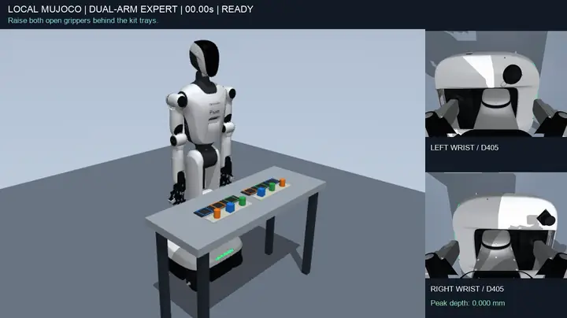
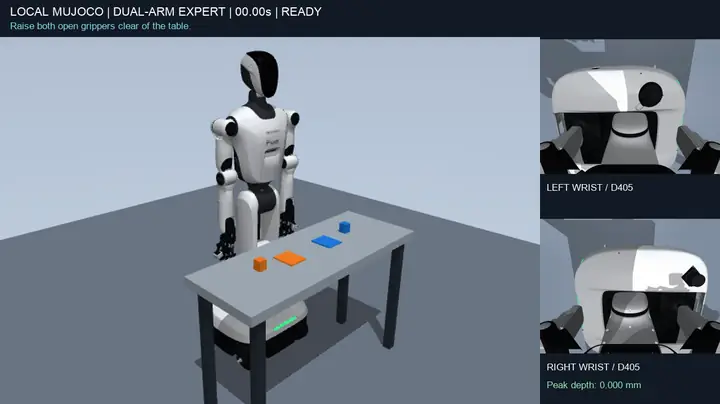
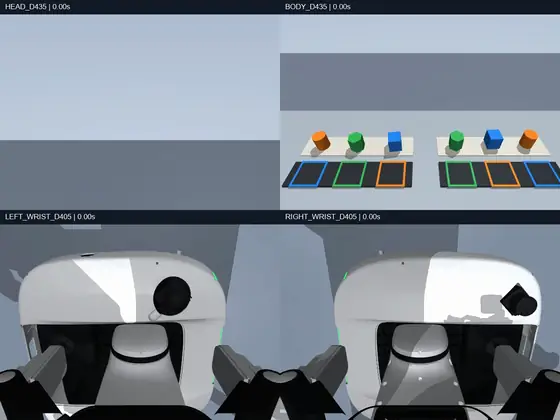

# Franzi 双臂机器人 MuJoCo 仿真

汇川（Inovance）Franzi 轮式双臂机器人的本机 MuJoCo 仿真，运行在 macOS 上，是把 FineART 用到这台机器人上的第一阶段。底盘固定，由带特权信息的脚本专家完成双臂任务并录制示教，先把本体模型、动作接口、夹爪接触和数据格式做对。这里还没有加载 FineART 权重。

<p align="center">
  
</p>
<p align="center">双臂分拣装盘（5 倍速）：每只手把三种零件放进料盘里同色的格子，右侧小图是两路腕部相机</p>

<p align="center">
  
  
</p>
<p align="center">左：双臂抓放（3 倍速）。右：四路机载相机（5 倍速），上排头部和躯干 D435，下排左右腕 D405</p>

动图是加速、缩小的预览。原始录像为 25 FPS、每个控制拍一帧，用下面的命令加 `--record` 生成。

## 内容

- **任务**，各占一个目录 `scenes/<名字>/`：
  - 双臂抓放 `pick_place`：两只手同时抓起蓝、橙两个物块，放到中间的目标垫上，松手撤回，约 30 s。
  - 双臂分拣装盘 `kitting`，给 VLA 训练用：每只手把供料垫上的方块、圆柱和六角柱放进料盘里同色的格子，两臂同步做 3 个回合，一集 63–110 s。布局、顺序和指令随种子变化。
- **RoboSyn 道具长任务**（`scenes/robosyn_*`，见 [docs/tasks.md](docs/tasks.md)）：厨房（揭盖、食材下锅和装盘、盖盖、按铃，另有换菜变体）、抽屉（拉开、双手经交接垫传递、收纳或取出烧杯、关上、按铃）、双手端托盘。道具来自 RoboSynChallenge，原始文件不入库。
- **按真机对齐的机器人模型**（`sim/`）：从未改动的源 URDF 和 MuJoCo 模型派生仿真场景。手腕和手指换成 CAD 网格碰撞体，夹爪按 CAD 连杆运动，关节限位和速度按控制器镜像收紧，腰腿和头部有重力前馈；外观按实验室和工厂视频上色。
- **四路机载相机**：头部、躯干 D435，左右腕 D405（装在新设计的倾斜相机块上，见 `hardware/wrist_d405_mount/`）。内参是未标定的模拟针孔。
- **共享运动学** `robot_kinematics.py`（Pinocchio）：笛卡尔目标都在主机上求解，仿真和真机都只接收关节指令。
- **原厂 SDK 仿真服务端** `simbridge/`：上层程序只调用未修改的原厂 V1R1C9 SDK，换一个连接配置就能在仿真和真机之间切换。
- **VLA 数据**（`data/`）：经原厂 SDK 录制，或转换专家的运行，导出为 LeRobot v3.0 数据集。

## 快速开始

需要 macOS 和 conda（mamba）。新建环境 `inovance-fineart`：

```bash
mamba create -n inovance-fineart -c conda-forge python=3.12 pip
mamba activate inovance-fineart
pip install mujoco==3.13.0 numpy==2.2.6 scipy==1.18.1 trimesh==5.1.0 av==15.1.0 \
  pillow==12.3.0 PyYAML==6.0.3 networkx==3.6.1 pytest==8.4.2 pin==3.4.0 \
  cmeel-urdfdom==4.0.1 cmeel-tinyxml2==10.0.0
```

`cmeel-urdfdom` 必须固定在 4.0.1：pin 3.4.0 链接的是 urdfdom 4.0，不固定时 pip 会装 6.0.0，Pinocchio 就无法导入。

在仓库根目录运行，`--output` 要指向一个还不存在的目录：

```bash
# 双臂抓放：无界面几秒；加 --record 约 1 分钟，另写 6 条 MP4
python -m scenes.pick_place.run --output outputs/pick_place --record
python -m scenes.pick_place.check outputs/pick_place   # 验收，不通过时抛 AssertionError

# 分拣装盘：一集无界面约 4 s，加 --record 约 3 分钟
python -m scenes.kitting.run --output outputs/kitting_seed0 --seed 0 --record
python -m scenes.kitting.check --output outputs/kitting_check --seeds 20   # 多种子验收，写 report.json

# 不依赖物理引擎的测试
python -m pytest tests -q
```

- 专家失败时进程仍以 0 退出，结果要看运行目录里 `summary.json` 的 `success` 和 `error`。
- 每次运行写 `scene.xml`、`summary.json`、`trace.json`（每个控制拍的阶段、动作、状态和物体真值）和 `trajectory.npz`；`--record` 另写总览 `expert.mp4`、四宫格 `cameras.mp4` 和四路相机各一条 640×480 的原始视频。详见 [docs/tasks.md](docs/tasks.md)。
- 原厂 SDK 和控制器镜像（`sdk_review/`）是第三方资料，不在仓库里。没有它时，原厂 SDK 的连接、SDK 验收和读取控制器镜像的测试无法运行。

## 目录

| 路径 | 内容 |
|---|---|
| `scenes/` | 每个任务一个目录：`task.py` 布局和物体，`run.py` 脚本专家和命令行，`check.py` 验收 |
| `sim/` | 各任务共用：派生机器人场景 `build_task.py`，外观 `appearance.py` 和 `fittings.py`，夹爪连杆 `gripper_linkage.py`，腕部相机块 `wrist_mount.py`，相机 `camera_rig.py`，仿真主循环和逐步审计 `episode.py` |
| `robot_kinematics.py` | 共享正逆解（Pinocchio），专家、SDK 服务端和主机侧笛卡尔控制都用它 |
| `simbridge/` | 原厂 SDK 的仿真服务端 |
| `sdk/` | 原厂 SDK 的连接、SDK 验收、主机侧笛卡尔控制和离线运动学核对 |
| `data/` | VLA 数据的录制、专家运行转换和 LeRobot 导出 |
| `config/` | 机器人与 SDK 的映射、连接和后端配置、规划约束原件、SDK 验收程序 |
| `assets/` | 源模型 `franzi_source/`（原样，不改）、外观网格和 RealSense 相机模型 |
| `hardware/wrist_d405_mount/` | 腕部 D405 倾斜相机块的设计 |
| `tests/` | 不依赖物理引擎的 pytest |
| `docs/` | 详细文档和 README 的动图 |

## 当前状态（2026-10-24）

| 检查 | 结果 |
|---|---|
| 双臂抓放 | 成功，30.0 s。最大接触穿透 0.099 mm，关节越限最大 0.5 mrad，每侧双指离地夹持 2518 步 |
| 分拣装盘，20 个种子 | 20/20 成功，120/120 个零件入格，一集 62.8–110.0 s。最大穿透 0.13 mm，越限最大 0.16 mrad，零件离格中心最多 0.58 mm |
| RoboSyn 道具长任务，5 种各 20 个种子 | 厨房做饭、换菜，抽屉收纳、取出，双手端托盘：全部 20/20 成功，每集 49–127 s。最大穿透 0.34 mm，越限最大 0.90 mrad |
| 工业 benchmark 场景，10 个 | 已搭好并通过场景检查（静置、穿透 ≤ 0.27 mm、关键点可达、相机可见），专家和成功判定还没写；见 [docs/benchmark.md](docs/benchmark.md) |
| 原厂 SDK 验收，MuJoCo 两种主循环 | 通信 28/28，控制语义 37/37，运动学接口 23/23，物理表现 10/10，故障处理 5/5；经 SDK 重放的完整任务成功 |

这些结果来自本机的 `outputs/expert_wrist_block/`、`outputs/kitting_check_wrist_block/`、RoboSyn 场景的 `outputs/*_check_*/` 和 `outputs/sdk_backends_v12/`（`outputs/` 不入库）。

还没有做的：

- 没有连接过真机。坐标映射、零位、限位和 TCP 只核对到「离线控制器镜像与 URDF 一致」。
- 相机内参未标定，没有深度图和噪声模型。
- Isaac Sim 后端是草稿，从未运行。
- 还没有加载 FineART 权重或训练策略。原 OMX 6 维策略要重建特征和归一化配置，再微调，才能用在这台双臂机器人上。

## 文档

- [机器人模型](docs/robot_model.md)：源文件、派生场景和碰撞体、夹爪连杆、运动学、关节限位和伺服、相机、外观和灯光
- [任务与专家](docs/tasks.md)：各任务的布局、专家、成功判据、数据约定和当前结果
- [原厂 SDK 仿真服务端](docs/sdk_bridge.md)：分层、控制语义、坐标映射、运动学接口和验收
- [VLA 数据](docs/vla_data.md)：经原厂 SDK 录制、转换专家运行、导出 LeRobot 数据集
- [控制器镜像离线检查](docs/controller_image.md)
- [历次版本](docs/history.md)：每一版改了什么、当时的结果和结论

## 版权

本仓库没有开源许可证，保留所有权利：欢迎查看，未经许可不得使用、修改或转载。第三方相机模型的来源和许可见 `assets/appearance/cameras/*/SOURCE.json`。
