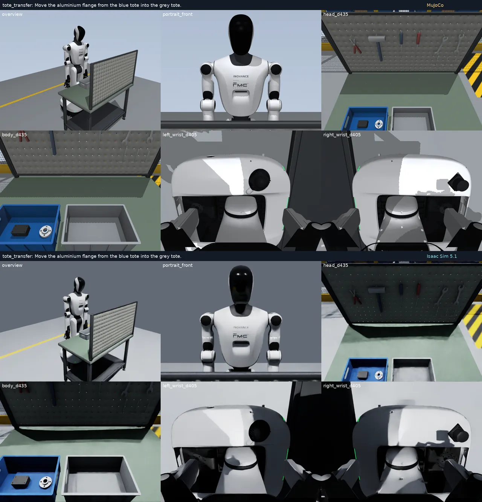

# Isaac Sim 版场景

工业 benchmark 的 10 个场景已经搭到了 Isaac Sim 5.1 上（PhysX 物理加 RTX 渲染，用户要求，2026-10-25）。移植的起点是每个场景在 MuJoCo 里编译好的模型，所以布局、碰撞体、质量、关节、伺服增益和相机都和 MuJoCo 版一样，换掉的只是物理引擎和渲染器。代码在 `isaac/`，不针对具体场景；RoboSyn 场景还没试过。



## 怎么跑

两步都在 pro6000 上跑（见 CLAUDE.md 的「Where things run」）。第一步用项目环境，第二步用 Isaac Sim 自带的 Python：

```bash
# 1. 编译场景并导出，同时跑一遍 MuJoCo 场景检查作参照（每个场景约半分钟）
python -m isaac.export tote_transfer panel_operation ... --output outputs/<新目录>
# 2. 生成 USD，在 PhysX 上检查（每个场景约 1 分钟）
ISAAC_PYTHON=<Isaac Sim 的 python> isaac/run.sh isaac.check outputs/<新目录>/<场景>
```

每个场景目录里有：

- `scene.usdc`：Isaac 场景，30–38 MB。可以直接在 Isaac Sim 界面里打开，物理设置（500 Hz、TGS）都在文件里。
- `paths.json`：运行时用的 prim 路径、驱动增益和连杆耦合。
- `model.json`、`arrays.npz`、`textures/`：导出的 MuJoCo 模型；`scene.xml` 是 MuJoCo 模型本身。
- `mujoco/`：MuJoCo 的场景检查（`sim/bench_check.py`），作对照。
- `check/`：Isaac 的检查。`report.json`、`preview.png`（总览、正面和 4 路策略相机），以及 `compare.png`（上半是 MuJoCo，下半是 Isaac）。

## 模型怎么对应

`isaac/stage.py` 的规则：

- **刚体。** 带铰链、滑轨或自由关节的物体成为一个刚体，焊在它上面的物体并进来，质量和惯量合并。手指同时有横向滑轨和下沉滑轨，拆成两个串联的刚体。底盘是固定的，所以车轮和转向关节直接焊死。
- **关节树。** 带关节的树各成一个 articulation，根部用固定关节固定在世界上：机器人、操作台、辊道、带盖周转箱、CNC。自由道具是普通刚体，没有关节的树是静态碰撞体。
- **关节和驱动。** 锚点、轴和行程照搬 MuJoCo，从 qpos0 起算。
  - 有伺服的关节用位置驱动，kp 取伺服的值，阻尼是关节阻尼加伺服的 kv。
  - 道具关节的弹簧和阻尼照搬。
  - 夹爪连杆的 26 个耦合关节用很硬的驱动；运行时每个物理步按手指滑轨的实测位置，用 MuJoCo 的四次多项式算出它们的目标（PhysX 只支持线性耦合）。
- **重力补偿。** 机器人各刚体不受重力，相当于 MuJoCo 里施加在各关节上的重力前馈。
- **接触。**
  - MuJoCo 的 contype/conaffinity 规则换成碰撞组，每种掩码一组；MuJoCo 规则下不该碰的组之间互相过滤。
  - 接触排除换成 filtered pairs。
  - 网格按凸包碰撞，和 MuJoCo 一样。
  - 摩擦取两者的最大值，和 MuJoCo 优先级相同时的规则一致。
- **外观。**
  - 用编译后的网格、法线和贴图坐标。
  - 材质用 UsdPreviewSurface，颜色从 sRGB 换成线性；自发光乘的是贴图颜色，和 MuJoCo 一样。
  - MuJoCo 第 3 组以后的几何体本来就不渲染，这些碰撞体在 USD 里设成 guide。
- **相机和灯光。** 相机挂在原来的物体上，朝向约定相同（都沿 −Z 看、+Y 向上），fovy 不变，近裁剪面同为 45 mm。MuJoCo 的两盏方向光换成 RTX 的远光，再加一盏蓝灰色的穹顶光。

## 检查结果（2026-10-25）

下表是场景改版前的结果。2026-10-25 这些场景又改过一轮（工作台升到 0.90 m，部分道具重建，几个布局重写，`carton_carry` 换成了 `tote_carry`），机器人的碰撞体也换成了各连杆的凸包。改版后重新导出、检查（`outputs/isaac_bench_v3/`），10 个场景都通过：自由物体漂移不超过 0.05 mm（`precision_insertion`），最深接触不超过 0.001 mm，位姿差 0.0004 mm；实时倍数 0.35–0.53，比下表低，因为检查时服务器上同时在跑别的仿真。

`isaac/check.py` 照 MuJoCo 场景检查的方式做：双臂下垂，头部在 3.3 s 内俯仰到 0.50 rad，静置 4 s。然后把机器人摆到一个随机姿态，和 MuJoCo 的正解逐个刚体比较。

| 场景 | USD | 自由物体漂移 (mm) | 最深接触 (mm)，Isaac / MuJoCo | 位姿差 (mm) | 实时倍数 |
|---|---|---|---|---|---|
| `tote_transfer` | 34.4 MB | 0.00 | 0.001 / 0.089 | 0.0004 | 0.90 |
| `panel_operation` | 35.1 MB | — | 0.000 / 0.003 | 0.0004 | 0.91 |
| `tray_push` | 34.9 MB | 0.00 | 0.000 / 0.089 | 0.0004 | 0.85 |
| `parcel_sorting` | 31.0 MB | 0.00 | 0.398 / 0.266 | 0.0004 | 0.88 |
| `carton_carry` | 37.6 MB | 0.00 | 0.000 / 0.089 | 0.0004 | 0.88 |
| `shaped_kitting` | 34.6 MB | 0.00 | 0.001 / 0.089 | 0.0004 | 0.87 |
| `lidded_tote` | 35.3 MB | 0.00 | 0.001 / 0.089 | 0.0004 | 0.90 |
| `palletizing` | 30.0 MB | 0.00 | 0.000 / 0.089 | 0.0004 | 0.89 |
| `cnc_tending` | 30.4 MB | 0.00 | 0.000 / 0.089 | 0.0004 | 0.71 |
| `precision_insertion` | 34.5 MB | 0.01 | 0.000 / 0.089 | 0.0004 | 0.76 |

10 个场景的共同结果：

- **驱动增益。** PhysX 从 USD 里读出的增益和设定值完全一致。USD 里转动驱动的增益按"每度"计，说明换算没错。
- **静置。** 头部到了 0.50 rad，手臂不动；操作台、辊道、周转箱盖和 CNC 的关节都没动。
- **运动学。** 随机姿态下 50 个机器人刚体的位姿和 MuJoCo 正解最多差 0.0004 mm、0.0°，说明关节坐标系、焊接合并和手指的两节链都对。
- **速度。** 实时倍数只算 500 Hz CPU PhysX 的静置，包括每步的连杆耦合和接触读取，不含渲染。

## 和 MuJoCo 的差别

- **关节恒定摩擦（frictionloss）没有移植。** PhysX 的关节摩擦是关节力乘一个系数，不是恒定的力。所以 CNC 门（3 N）、虎钳（1 N）以及按钮、旋钮的小摩擦都没了；静置时这些关节没动。
- **接触优先级没有对应。** `tray_push` 的托盘摩擦是 0.25，MuJoCo 靠优先级让它压过台面和导轨的 0.6；PhysX 里两者取最大值 0.6，托盘会比 MuJoCo 里难推。写这个场景的专家时要处理。
- **凸包上限。** PhysX 的凸包最多 255 个顶点。腕部有 26 块碰撞体超过这个数（最多 1740），PhysX 会简化它们。
- **手指不受重力。** Isaac 里手指滑轨也不受重力；MuJoCo 里手指没有重力前馈，手倾斜时会沿滑轨下滑几毫米。
- **夹着的零件不往下滑。** MuJoCo 的软摩擦让夹着的零件沿夹垫慢慢下滑（0.1–0.6 mm/s），PhysX 有静摩擦，零件不滑。放下时不能靠蠕滑让零件落到支撑面上：按蠕滑设计、离支撑面 3 mm 松手的专家，在 Isaac 里零件真的掉下 3 mm（旧模型的 CNC 交接台，穿透 1.18 mm）。现在所有专家都在放下前重新量零件，送到离支撑面 0.5 mm 以内再松手。旧模型上夹在台阶上的 CNC 成品会绕两块夹垫的连线偏 2–4°；新模型上夹持都对着零件轴线，偏不到 0.2°。
- **松手后的接触流形。** 平放到台面上的零件松手后，PhysX 默认的 PCM 接触流形只在零件中心附近留一个接触点，零件像倒立摆一样慢慢倾倒，倾到 1–1.7° 时才生成边缘的接触，这时边缘已经陷进台面约 20 mm × sin（倾角）。之后零件被弹回、放平（cnc_tending 的 agent 逐个物理步记下来的）。新模型上 CNC 交接台最深 0.59 mm，在 1 mm 审计线以内；旧模型上零件松手前已偏 2–4°，到了 1.06 mm。改用 SAT 碰撞后不再倾倒，但出现过一次 1.79 mm 的手指-零件接触，所以移植没改，仍用 PCM。
- **没有铰链摩擦的后果。** 带盖箱的盖子掀过 84° 后比手快约 2°，松手后倒到 110° 限位（专家从 105° 和 110° 两种起点规划合盖）；急停自己滑到 5 mm 限位（成功判定只查机器人有没有碰它）；旧模型上 CNC 门被经过 10 mm 外的手带开 0.106 m，新专家的手离门至少 88 mm。
- **渲染。** RTX 按物理计算光照，灯光强度是对着料箱转运的渲染效果挑的：主光 1200、补光 750、穹顶 180。因为有真实遮挡，封闭的 CNC 机箱里比 MuJoCo 暗（MuJoCo 只有主光投阴影）。
- **启动设置。** 测速时借来的一长串 Kit 参数（关 DLSS、不开视口、RTX data window）在 5.1 上 900 s 都拿不到相机画面，改回最简配置后 0.1 s 就出图。半透明材质（CNC 门窗）要打开 `/rtx/raytracing/fractionalCutoutOpacity` 才透明。无头模式下的默认视口（1280×720）每次更新都会渲染，却没有人读它；2026-10-27 起用 `disable_viewport_updates` 关掉（见「速度」）。

## 专家在 Isaac 里闭环运行

用户 2026-10-25 选定专家直接在 Isaac 里闭环跑（另一种做法是在 MuJoCo 里规划、到 Isaac 里回放）。在 pro6000 上：

```bash
ISAAC_PYTHON=<Isaac Sim 的 python> isaac/run.sh isaac.episode tote_transfer --output outputs/<新目录> --seed 0 [--record]
```

`isaac/engine.py` 的 `isaac_scene()` 接收场景的 MuJoCo 场景类（`sim.tabletop.ObjectScene` 的子类），返回一个物理改在 PhysX 上跑的版本。场景的专家、条件和成功判定一行不改：

- **建场景。** 每个回合照常搭好并编译 MuJoCo 模型，再导出、生成这一回合的 USD，放在 `<运行目录>/isaac/`。
- **每个物理步。** 先按场景的 goal、grip 和头部俯仰设置 Isaac 的关节目标，再推进 PhysX，然后把 Isaac 的状态抄回 MuJoCo 的 data：机器人和道具的关节、自由物体的位姿和速度，再算一次 `mj_kinematics`。这份 MuJoCo 数据只当运动学"影子"，专家和场景读到的位置、速度、关节值都来自 Isaac。
- **接触。** 来自 PhysX 的接触报告，映射回 MuJoCo 的物体和几何体（没名字的几何体在 `paths.json` 里记作 `geom<序号>`），用于抓取证据、1 mm 的穿透审计和接触审计（`Scene.audit_contact` 和搬运中物体的检查），所以两边的成功判定一致；`check_physics()` 在影子状态上照样跑。PhysX 会报告 4 mm 接触偏移以内还没碰上的物体对，所以只有间隙不到 0.5 mm 才算接触。正面对照：让料箱转运里闲着的右手压到工作台上，两根手指都记成了碰撞。
- **录像。** 总览和 4 路策略相机在 RTX 上渲染，写出的视频和文件与 MuJoCo 运行完全相同，`data.convert_expert_run` 照样能读。`summary.json` 的 `simulator` 字段注明是 Isaac Sim，转成原始数据后保留在 `source_run.simulator` 里。
- **帧和状态对齐。** 每帧画面对应同一控制步的状态（2026-10-25 修复）。
  - PhysX 的结果只有经过 Kit 的更新循环才会交给渲染器，每次 `world.render()` 就是一次这样的更新。
  - `Runtime.render()` 一直渲染，直到每台相机最新一帧的 `rendering_time` 等于当前仿真时间；更早状态的画面带的是更早的时间。为此相机要保留每一帧（`_frequency = -1`），Isaac 的 Camera 默认会跳过仿真时间没变时渲染的帧。
  - 应用按 Isaac 自带的"零延迟"配置启动（`isaacsim.exp.base.zero_delay.kit` 里的 `/app/hydraEngine/waitIdle` 和 `/app/updateOrder/checkForHydraRenderComplete`）：每次更新都等这一帧渲染完，所以渲染一次就拿到当前帧。不开时，相机要再渲染两到四次才交出这一帧，GPU 越忙次数越多，每次都把所有相机重画一遍。
  - 录制前（`prepare()` 期间），每个控制步的最后一个物理步用 `world.step(render=True)`。渲染步长和物理步长相同，所以这次 Kit 更新只推进一个物理步，同时渲染一次，让 RTX 的降噪和光照缓存在第一帧之前就热起来。2026-10-28 之前，录制时每步也走这一次"同步步"，每帧渲染两次；现在录制时每帧只渲染一次。在 `tray_push` 种子 0 上和两次渲染的版本同时起跑对照（2026-10-27）：
    - 物理逐位相同；帧对齐检查偏移 0、比值 3.38（两次渲染 4.24）。单个进程快 1.26 倍（0.258 对 0.204 倍实时）。
    - 画面稳定后，和两次渲染的版本每路平均差 1.3–1.8 个灰度级；两次渲染的两次运行之间差 0.7–1.1。快速运动时拖影略重。
    - 录制前也完全不渲染时，第一帧还混着场景加载时的姿态，要 200–400 帧（8–16 s）才收敛，所以录制前保留这次渲染。
  - 试过但不行的：等帧时暂停渲染产品（`hydra_texture.set_updates_enabled`），帧就送不出来了；同步步时暂停，画面变糊（时间降噪少了一帧）。
  - 修复前画面比状态晚一个控制步（40 ms）。起初只渲染一次、没有同步步；后来加了同步步、固定渲染两次，仍然晚一步。当时用"瞬移"头部偏航的探针验证，以为修好了；关节由驱动带着动时才看出来。这些录像都已作废。
  - 检查办法：`isaac.episode --settle 4` 用同一个种子重跑一遍，每帧多渲染 4 次（物理完全相同），`data.frame_lag.frame_offset` 在相机动得最多的帧上，找出录像和这些稳定画面对得上的偏移。任务版本 3 的种子 0 和 9：偏移 0，平均差 1.77，偏移 ±1 时是 6.4–7.6。`isaac.collect` 对每批第一个成功的种子做这项检查，不通过就不导出。
  - `data.frame_lag.frame_lag` 只看录像本身，算状态推出的相机运动和相邻帧变化的相关。录进抬手动作时它判得出（修复前 +1，MuJoCo 0，领先约 0.01）；回合从默认姿态开始后曲线是平的，判不出，还把种子 9 误判过。
  - 快速运动时，第一帧新画面还会混进一点前几帧（RTX 的时间降噪），平均差 1–3 个灰度级，像轻微的运动模糊。`omni.physx.fabric` 和 Replicator 相机一起用会崩溃。
- **完整记录。** `log_full()` 的关节力取 PhysX 实测的关节力，加上 MuJoCo 影子算出的重力和科氏力项（Isaac 里机器人不受重力），和 MuJoCo 版"伺服力加前馈"的含义相同；接触力取 PhysX 报告的接触对的力。深度和分割视频暂时不录：MuJoCo 版的这两路来自 MuJoCo 的渲染器，RTX 的深度还没接上。

场景的 `run()` 要接受 `engine` 参数，10 个工业场景都支持。

为此 Isaac Sim 的 Python 里装了 MuJoCo 3.13.0、PyAV 15.1.0 和 Pinocchio 2.7.0（只新增，Isaac 原有的包没动）。Pinocchio 用 2.7.0，是因为 3.x 的 wheel 要求 numpy 2，而 Isaac Sim 5.1 用的是 numpy 1.26。和项目环境的 pin 3.4.0 相比，逆解结果差 7.5e-14 rad 以内，`tote_transfer` 的种子采样完全一样。Kit 里的 pin 2.7 不能按下标读 `model.parents`（报 "No Python class registered for C++ class std::vector<unsigned long>"），帧的父关节也叫 `parent` 不叫 `parentJoint`，所以换新模型时加的根坐标变换一开始让每个 Isaac 回合都起不来；现在 `robot_kinematics.root_joints()` 从 URDF 的树里找挂在根上的关节，Kit 里两只手的正运动学和 pin 3.4 完全相同（2026-10-25）。

`tote_transfer` 种子 0（搬塑料壳），两边都成功：

| | MuJoCo | Isaac Sim |
|---|---|---|
| 时长 | 33.68 s | 33.75 s |
| 双爪夹住并离地的物理步数 | 3201 | 3214 |
| 塑料壳最高点 | 0.9855 m | 0.9864 m |
| 塑料壳最终位置 | — | 与 MuJoCo 差 0.3 mm |
| 最深接触 | 0.36 mm | 0.001 mm |
| 墙钟时间 | 3.4 s | 不录像 44 s，录像 96 s |

录像的 6 路视频都是 844 帧，和轨迹的 844 个控制步一一对应。上表的墙钟时间是帧对齐修复前测的；修复后录像慢一些，比如种子 10 的 37.3 s 回合用了 141 s（0.26 倍实时）。

## 录数据

`isaac.collect` 一步把一个场景的专家示范录成 LeRobot v2.1 数据集。它在 pro6000 的项目环境里运行；长批次放在冻结的快照里跑（见 CLAUDE.md 的「Where things run」）：

```bash
ISAAC_PYTHON=<Isaac Sim 的 python> python -m isaac.collect tote_transfer --seeds 0-19 --output outputs/<新目录> [--parallel 8]
```

- 每个种子在单独的 Isaac 进程里闭环录一个回合（`isaac.episode --record`），同时最多跑 `--parallel` 个。
- 录完后，第一个成功的种子用 `--settle 4` 重跑一遍，检查画面是否在自己的控制步上（见上面的「帧和状态对齐」）；不通过就什么都不导出。
- 成功的回合转成原始数据（`raw/`），再导出成一个 v2.1 数据集（`lerobot_v21/`）。要 v3.0，就在 lerobot 环境里用 `data.convert_lerobot` 转。
- `collect.json` 记下每个种子的结果、错误和用时，以及这项检查的结果。
- `--fill`：失败的种子由列表之后的新种子补上，最多多跑列表长度的 20%，让成功的回合数等于列出的种子数。
- `--display N`：只有前 N 个种子录总览 `expert.mp4` 和四宫格 `cameras.mp4`，其余只录 4 路策略相机（`isaac.episode --no-display`），数据集和帧对齐检查都只用这 4 路。不录展示视频快约 20%：`tote_transfer` 种子 0 三个进程并行时 3 分 43 秒，录展示视频 4 分 40 秒；轨迹逐位相同。
- **光照随机（2026-10-27，用户选定）。** 每集的光照按它的种子抽取（`isaac/stage.py` 的 `RANDOM_LIGHT`），所以同一个种子每次渲染都一样，帧对齐检查的重跑也对得上；没有种子的模型（场景检查）用标称光照。`<运行目录>/isaac/lighting.json` 记下这一集的光照。
  - 主光和补光的强度 ×0.6–1.4，色温 5000–6500 K；平行光的方位转 ±30°、仰角变 ±10°（不低于 15°）；穹顶强度 ×0.6–1.5。
  - 只改渲染：`tote_transfer` 种子 0 在随机光照和标称光照下轨迹数组逐位相同，画面平均差 13–15 个灰度级。
  - 色温下限试过 3500 K（最暗那档整片琥珀色）和 4200 K（米黄）。RealSense 彩色相机开着自动白平衡，真机上光源的偏色大多会被去掉，所以只留 5000–6500 K 的轻微冷暖。

**数据集（2026-10-25，`tote_transfer`）。**

| 批次 | 内容 | 状态 |
|---|---|---|
| 第一批 | 种子 0–19，回合从手臂下垂、头抬着开始，录进了抬手和低头；20 条，18 644 帧，572 MB | 已被第二批取代 |
| 第二批 | 任务版本 3：回合从默认姿态开始（两只夹爪端在身前、头已低下），摆姿态的 6.6 s 不录；种子 0–19 都成功，20 条，15 716 帧，499 MB | 旧机器人模型 `wheel_robot_4.0`，作废 |

**数据集（2026-10-25，新机器人模型 `wheel_robot_26.8.16_3`，10 个工业场景）。** 每个场景种子 0–9，在冻结快照里分两条线、每条 3 个并行录（同时还有别人的 RoboSynChallenge 任务占着 CPU 和 GPU），13:09 到 17:37 共 4.5 小时。每个回合都按 subtask 规则切开，数据集逐帧的 `subtask` 列就是 subtask 文本（"Pick up the hex blank with the right hand." 这样），细动作阶段不在里面。

| 场景 | 成功 | 帧数 | 大小 | 一集 | 帧对齐（偏移，比值） |
|---|---|---|---|---|---|
| `tote_transfer` | 10/10 | 10 448 | 333 MB | 40.3–47.6 s | 0，4.21 |
| `panel_operation` | 10/10 | 9 527 | 294 MB | 37.4–39.6 s | 0，3.19 |
| `tray_push` | 10/10 | 6 680 | 224 MB | 25.6–28.4 s | 0，4.09 |
| `parcel_sorting` | 10/10 | 28 526 | 1586 MB | 113.2–116.3 s | 0，4.28 |
| `tote_carry` | 10/10 | 7 999 | 253 MB | 31.9–32.1 s | 0，4.77 |
| `shaped_kitting` | 10/10 | 28 764 | 902 MB | 111.3–116.3 s | 0，2.65 |
| `lidded_tote` | 10/10 | 19 954 | 557 MB | 78.3–82.4 s | 0，3.68 |
| `palletizing` | 10/10 | 28 207 | 1479 MB | 110.0–115.7 s | 0，4.09 |
| `cnc_tending` | 9/10 | 40 559 | 1043 MB | 179.7–181.0 s | 0，3.26 |
| `precision_insertion` | 10/10 | 12 394 | 352 MB | 48.3–52.8 s | 0，2.68 |

- 共 99 集、193 058 帧，数据集约 7.0 GB（连同运行目录和原始数据共 19 GB）。每个场景的帧对齐检查都通过，99 集的 `data.subtask_check` 都通过。
- `cnc_tending` 种子 8 失败：成品放到交接台上松手后，PCM 接触流形让它倾倒，边缘陷进台面 1.10 mm，超过 1 mm 审计线（见「和 MuJoCo 的差别」）。这一集没有导出。
- 这批是在共享代码修 `robot_kinematics.ik()` 的初值和 `tabletop.TIP` 之前采的；修了以后同一个种子重跑，回合可能和数据集里的不一样，但这批仍是有效的示范。
- 总览相机只用来做展示视频：`tote_transfer` 里它被工作台上的洞洞板挡住了料箱，`cnc_tending` 里被机床挡住大半。

以下是旧模型的批次：

- 第二批的零件是塑料壳或铝法兰，指令有三种说法，共 6 条任务文本；一集 26.4–40.0 s。
- 对齐：种子 0 和 9 按 `--settle` 重跑对比，偏移都是 0。最初的相关估计把种子 9 判成晚一步、没有导出，后来补回。
- 第二批是 4 个并行、开零延迟之前录的：录像 22.2 分钟（0.47 倍实时），转换和导出另用约 2 分钟。

**数据集（2026-10-27 至 28，每个场景 200 条）。** 用户要每个场景采 200 条，并且注意随机化。布局随机化放大了（任务版本和范围见 [benchmark.md](benchmark.md)「随机化放大」），每集的光照按种子随机（上面的「光照随机」）。在冻结快照里分两条线、每条 4 个进程录（`--seeds 0-199 --fill --display 2`），从 10-27 03:45 到 10-28 19:12，共 39.4 小时；最后 3.6 小时 `tray_push` 提前开在第三条线上（见「速度」）。

| 场景 | 任务版本 | 成功（共跑的种子） | 帧数 | 大小 | 一集 | 帧对齐（偏移，比值） |
|---|---|---|---|---|---|---|
| `tote_transfer` | 6 | 200（200） | 214 999 | 6.8 GB | 34.3–52.3 s | 0，4.11 |
| `panel_operation` | 4 | 200（200） | 203 595 | 6.5 GB | 38.2–62.1 s | 0，2.59 |
| `tray_push` | 4 | 200（201） | 135 025 | 4.7 GB | 23.5–32.9 s | 0，3.45 |
| `parcel_sorting` | 4 | 200（200） | 565 600 | 31.7 GB | 109.4–129.7 s | 0，4.13 |
| `tote_carry` | 5 | 200（200） | 172 074 | 5.4 GB | 32.9–38.5 s | 0，3.99 |
| `shaped_kitting` | 4 | 200（200） | 612 106 | 19.5 GB | 109.6–150.6 s | 0，2.76 |
| `lidded_tote` | 4 | 200（204） | 481 571 | 13.8 GB | 86.6–111.7 s | 0，3.48 |
| `palletizing` | 4 | 200（200） | 658 252 | 34.3 GB | 116.4–180.8 s | 0，3.77 |
| `cnc_tending` | 5 | 200（228） | 915 212 | 25.1 GB | 179.3–196.2 s | 0，3.04 |
| `precision_insertion` | 4 | 200（202） | 259 034 | 7.5 GB | 49.5–59.0 s | 0，2.79 |

- 共 2000 集、4 217 468 帧（46.9 小时），数据集 155.5 GB。连同运行目录（146.6 GB）和原始数据（43.2 GB），快照的 `outputs/isaac/` 共 346 GB。汇总在快照的 `outputs/isaac/summary.json`。
- 每个场景的帧对齐检查都通过，2000 集的 `data.subtask_check` 都通过。
- 共跑了 2035 个种子，仿真 47.5 小时（含不录的准备阶段和失败的回合），平均 1.20 倍实时。
- 失败的 35 个种子没有导出，由 `--fill` 用 200 号起的新种子补上：
  - `cnc_tending` 28 个。其中 27 个是零件（成品或毛坯）放到交接台上松手后，PCM 接触流形让它倾倒，边缘陷进台面 1.008–1.247 mm（见「和 MuJoCo 的差别」）。种子 70 是右手离开交接台时，一根手指擦到控制面板（31 个物理步，深度 0）。
  - `lidded_tote` 4 个：合盖时左手指陷进盖子 2.10–2.25 mm。
  - `precision_insertion` 2 个：插销钉时右手两指一直贴着工装（6–7 s，深度不到 0.005 mm），接触审计判失败。
  - `tray_push` 1 个：推过一半后，左手直线推进的一个路点逆解无解（x 0.475，接近竖直向下抓取的可达边）。推的起点按实测的托盘位置定，所以这条逆解链和采样器规划的不完全一样。
- 每帧渲染两次的回合：`parcel_sorting`、`shaped_kitting`、`lidded_tote`、`palletizing`、`cnc_tending` 全部，`tote_transfer` 种子 000–049，`precision_insertion` 种子 000–075。其余是 10-28 12:15 以后录的，每帧渲染一次（见「帧和状态对齐」）。两种画面平均差 1.3–1.8 个灰度级，一次渲染的运动模糊略多一点。
- `cnc_tending` 约 0–40 号、`palletizing` 约 0–60 号录的时候默认视口还开着，这只影响速度。快照里的 `outputs/isaac/NOTES.txt` 有逐个种子的划分。
- 一集比 10-25 那批长（`palletizing` 最长 180.8 s，原来 115.7 s）：东西散开以后路更远，有些转手改成了原地分步转。
- 只有每个场景的前两个种子录了展示视频（`expert.mp4`、`cameras.mp4`）。

**速度（pro6000：24 核、125 GB 内存、一块 RTX PRO 6000）。** 渲染探针同时起跑，不含专家本身的计算：

| 并行进程数 | 不开零延迟：每帧渲染次数 | 总吞吐（倍实时） | 开零延迟：每帧渲染次数 | 总吞吐（倍实时） |
|---|---|---|---|---|
| 1 | 2.0 | 0.31 | 1.0 | 约 0.38 |
| 4 | 2.6 | 0.62 | 1.0 | 0.84 |
| 8 | 3.8 | 0.60 | 1.0 | 1.21 |

- 不开零延迟时，GPU 越忙，新画面来得越晚，要重画的次数越多，所以 8 个并行和 4 个一样快。开了以后每帧只渲染一次，8 个并行快一倍。
- 真实回合 8 个并行（`isaac.collect` 的默认）：种子 0–7 录了 243 s，用 304 s，总计 0.80 倍实时。当时 CPU 负载 30–54（24 核），GPU 忙 26–97%，功耗 200–235 W（满载 600 W），我们以为瓶颈是 CPU，后来的测量否定了这一点。
- 200 条批次（2026-10-27，`cnc_tending` 和 `palletizing` 各 4 个并行）：总计 1.20 倍实时，单个进程 0.14–0.16 倍。
  - 用 py-spy 采样主线程：每个控制步两次 Kit 更新（同步步和取帧），共占 58%；19 个 PhysX 步占 20%，写视频占 5%。
  - CPU 一半空闲。GPU 在 40 s 里平均 79% 的时间在忙，功耗却只有 227 W：各进程的小渲染任务在 GPU 上轮流执行。
  - 再加 4 个进程，总吞吐只到 1.25 倍。瓶颈是 GPU，加进程没用。
- 关掉默认视口：`tray_push` 种子 0 和不关的版本同时起跑，快 9%（0.158 对 0.145 倍实时）。
  - 物理逐位相同，帧对齐检查偏移 0、比值 4.27。
  - 和不关视口的那次相比，画面每路平均差 1.37–1.47 个灰度级；两次都不关时也差 1.32–1.44（RTX 每次渲染都略有不同）。
  - 200 条批次从 07:40 起用上。
- 录制时每帧只渲染一次（见「帧和状态对齐」）：`tray_push` 单个进程快 1.26 倍。它的准备阶段占仿真时间的 27%，那一段照旧每步渲染一次。
  - 200 条批次从 10-28 12:15 起用上：`precision_insertion` 种子 076 起、`tote_transfer` 种子 050 起，以及 `panel_operation`、`tray_push` 和 `tote_carry` 全部。之前的回合每帧渲染两次（快照里的 `outputs/isaac/NOTES.txt`）。
  - 批次里同样是这两个场景各 4 个进程：切换前 40 分钟（11:35–12:15）总吞吐 1.66 倍实时，切换后一小时（12:25–13:25）2.02 倍。单个进程 `tote_transfer` 从 0.248 倍到 0.322 倍（快 1.30 倍），本来就慢的 `precision_insertion` 从 0.192 倍到 0.232 倍（1.21 倍）。
  - 切换后 GPU 平均忙 48%、功耗 177 W，CPU 还空 24%（每个进程约 2 个核），两边都没跑满。
  - 于是 15:33 起把 `tray_push` 放到第三条线上提前跑（4 个进程，nice 10），共 12 个进程。总吞吐只从 2.13 倍升到 2.43 倍：原来那 8 个进程每个慢了 23–30%（`panel_operation` 从 0.270 倍降到 0.207 倍，`tote_carry` 从 0.262 倍降到 0.184 倍），nice 10 的那条线反而有 0.217 倍。CPU 还空 16%，GPU 忙 51%，所以抢的不是 CPU 时间，nice 不起作用。这样做的好处是收尾时不再只有 4 个进程单独跑：整批预计提前约 50 分钟结束。
- 每个进程占 8–11.5 GB 内存，最多开 10 个左右。
- 一个进程开多个环境暂时用不了：
  - GPU 版 PhysX 需要支持 sm_120 的 torch。Isaac 自带的 2.7.0 不支持，Isaac Lab 用的是 cu128 版。另外，GPU 上的凸包最多 64 个顶点。
  - Isaac Lab 的设置（关 `updateToUsd`、开 Fabric）让物理快 5.8 倍，但相机出不了图。
  - 分块相机（tiled）一次能渲 256 路；64 个独立的渲染产品会卡死。

**还要做的。**

- 10 个场景的专家在新机器人模型 `wheel_robot_26.8.16_3` 上都通过了（2026-10-25）：MuJoCo 种子 0–19、Isaac 种子 0–2 闭环都成功，subtask 检查都通过，见 [benchmark.md](benchmark.md) 的「专家」一节。在这之前用旧模型采的数据（上表和 2026-10-25 的 10 场景批次）都作废，按用户的决定在新模型上重采：2026-10-25 每个场景 10 条，2026-10-27 至 28 每个场景 200 条（见上面的「数据集」）。
- `cnc_tending` 在 Isaac 上有 12% 的回合（228 个里 27 个）因为交接台上松手后的 PCM 倾倒超过 1 mm 审计线（见「和 MuJoCo 的差别」），是否在移植层修，等用户决定；`lidded_tote` 合盖时手指陷进盖子 2.1–2.25 mm（204 个里 4 个），也还没查。
