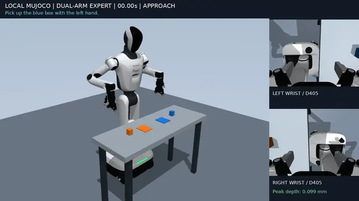

# 任务与专家

每个任务一个目录 `scenes/<名字>/`：`task.py` 是布局和场景物体，`run.py` 是 `Scene` 的子类、脚本专家和命令行，`check.py` 是验收。各任务共用 `sim/` 里的机器人场景、仿真主循环（`sim/episode.py` 的 `Scene`）、逐步审计、录制和 16 维数据约定。机器人模型本身见 [robot_model.md](robot_model.md)。

> 2026-10-25 机器人模型换成了 `wheel_robot_26.8.16_3`（见 [robot_model.md](robot_model.md)）。双臂抓放和分拣装盘已在新模型上按 subtask 重写并验证（结果见各自一节）；RoboSyn 五个场景下文的结果还是上一版 `wheel_robot_4.0` 上测的，这些专家在新模型上准备阶段指尖就碰到桌面，要重做。十个工业场景的专家由另一个会话在新模型上重写。新模型的场景检查里，十个工业场景都能稳定下来（最深接触 0.09 mm，物体不漂移）：六个场景的每个关键点都能到达、能夹取，tote_transfer（`grasp_flange`）、tray_push（`push_end`）、shaped_kitting（`pocket_l_bracket`）、precision_insertion（`seat_bearing`）各有一个关键点到不了（pro6000 上的 `outputs/urdf_bench_<场景>/`）。

## 共同约定

### 仿真与控制

- MuJoCo 500 Hz，控制 25 Hz，关节目标在两个控制拍之间保持不变。每 20 个物理步记一个 trace 采样（测量状态和即将执行的动作），每路视频渲染一帧。
- 底盘固定。机器人只经位置执行器的 `ctrl` 驱动，另加重力前馈（`qfrc_applied = qfrc_bias`）。
- 每个物理步之后检查：任一接触穿透超过 1 mm，或关节越限超过 0.002 rad，就抛 `RuntimeError` 结束这一集。
- 接触审计（用户 2026-10-25 要求：不能碰撞）。每个物理步都检查机器人的每个接触，只允许两种：底盘、轮子和转向节碰地面；手（`wrist_roll` 连杆及其下面的一切）碰能动的东西，即自由物体、按钮、盖子、抽屉这类。其余都算碰撞：两臂相碰、手臂碰躯干（2026-10-25 起检测）、手臂碰桌子或车架。另外，搬运阶段（场景的 `CARRY_PHASES`）手里的物体只能碰机器人。有任何一项，这一集就不算成功。`summary.json` 的 `physics.collisions` 和 `carried_collisions` 列出每一对碰撞：第一次出现的时间和阶段、持续的物理步数、最深的穿透。Isaac Sim 里用 PhysX 的接触报告走同一套审计。
- 物理崩溃另算：MuJoCo 报状态异常（`mj_step` 会悄悄重置状态）、接触或约束缓冲溢出（会丢接触）、状态不是有限值、自由物体快过 10 m/s 或 200 rad/s，都会抛 `PhysicsError`。这一集记为 `"void": true`，作废后换种子重来，不计入成功率；RoboDojo 对 PhysX 崩溃的环境也是这样处理的。
- `Scene.move` 用五次最小加加速度曲线。默认在关节空间的逆解之间插值；`linear=True` 时沿笛卡尔直线每 1 cm 取一个逆解路点，每个路点从上一个解出发。
- `Scene.move` 随后把每段动作拉长，直到 25 Hz 的手臂指令不超过控制器速度、加速度上限的 0.9 倍（按真机默认的 30% 速度比例；用户 2026-10-24 确定）。真机按默认比例回放时就不会被限速。这些上限来自离线控制器镜像，没有在真机上验证。

### 实验规则

- 抓取只靠接触和摩擦。不用焊接或吸附约束，复位后不写物体位姿，运行中不改碰撞 mask，不写机器人的 qpos 和 qvel。夹爪连杆的关节等式只把机器人自己的关节耦合在一起（类似 URDF 的 mimic），属于机构，不是抓取约束。
- 物体真值只给专家和评分用，绝不作为策略输入。
- 腿保持直立（小腿、大腿关节为 0），与实验室真机照片一致；不用工厂视频里的 Z 形蹲姿（用户 2026-10-24 确定）。

### 16 维状态与动作

- 顺序：左臂 7 个关节角（rad，`ARM_JOINTS` 顺序），右臂 7 个，左夹爪闭合度，右夹爪闭合度（0 全开，1 全闭）。
- 两根手指的位置目标等量反向，各 0.0475·g m。测量闭合度为 (q1 − q2) / 0.095。
- 这里用 URDF 的关节约定。经原厂 SDK 录制的数据用 SDK 约定，见 [vla_data.md](vla_data.md)。

### 相机

策略输入是四路机载相机：头部 D435、躯干 D435、左腕 D405、右腕 D405，均为 640×480，随实际关节状态运动（见 [robot_model.md#相机](robot_model.md#相机)）。总览 `overview` 等世界相机只作展示，不作策略输入。

### 每次运行的输出

- `scene.xml`：派生场景。网格按绝对路径引用，只能在生成它的 checkout 里加载。
- `summary.json`：结果、物理统计、数据约定，以及碰撞、外观和相机的元数据。
- `trace.json`：每个控制拍一条，含阶段（`phase`）、阶段指令（`subtask`）、动作、状态和物体真值。`trajectory.npz` 是同样的数值轨迹。
- `--record` 时另有 `expert.mp4`（总览加双腕小图，带阶段提示）、`cameras.mp4`（四路相机四宫格）和 `head_d435.mp4`、`body_d435.mp4`、`left_wrist_d405.mp4`、`right_wrist_d405.mp4`（640×480 原始画面），都是 25 FPS，每个 trace 采样一帧。
- 专家失败时进程仍以 0 退出：专家里抛出的 `RuntimeError` 和 `ValueError` 被捕获，写进 `summary.json` 的 `success` 和 `error`；`PhysicsError` 另记 `void`。
- 轨迹是专家的原始采集，不是 LeRobot 数据集。转换和导出见 [vla_data.md](vla_data.md)，导出时要保留相机时间戳和动作语义。

## 双臂抓放（`scenes/pick_place/`）

左手把蓝色物块、右手把橙色物块依次抓起，放到中间的两个宽目标垫上，松手后收回。两只手轮流做，每段 subtask 只有一只手动（2026-10-25 起）。

<p align="center"></p>
<p align="center">双臂抓放（3 倍速），右侧小图是两路腕部相机</p>

```bash
python -m scenes.pick_place.run --output outputs/<新目录> [--record]   # pro6000 上无界面约 10 s，--record 约 5 分钟
python -m scenes.pick_place.check outputs/<运行目录>                    # 写 verification.json，不通过时抛 AssertionError
python -m scenes.pick_place.task                                        # 只生成场景：outputs/pick_place_task.xml
```

### 布局

- 物块中心在 x = 0.38 m，目标垫在 x = 0.40 m（`task.py` 的 `SOURCES`、`GOALS`）。
- 布局由相机能看到的范围决定。头部俯仰 0.50 rad（关节上限 0.52 rad）时，头部 D435 从约 x = 0.33 m 起才看得到桌面；而逆解在 x 约 0.45 m 以外无解。物块放在原来的 x = 0.28/0.30 m 时，头部相机整段都看不到工作区，所以不要往回挪。
- 现在从接近到放置，头部和躯干相机都能同时看到两个物块、两个目标垫和两只手。

### 专家

- 从默认姿态开始（`tabletop.start_home`，录制前完成）：两手在准备点 (0.15, ±0.37, 0.99) m，手指朝下，夹爪张开 85 mm，头部低头看工作区。
- 先左手、后右手，每只手三段 subtask：抓起物块（approach、align、grasp、lift），放到目标垫上（transfer、place、release），收回到起始姿态（retract、finish）。指令写进 trace 的 `subtask`，例如 “Pick up the blue box with the left hand.”，阶段名写进 `phase`。一只手动时，另一只手的关节目标和夹爪都不变（`data.subtask_check` 检查）。
- align、lift、transfer、place 和 retract 走笛卡尔直线。工作区靠近臂展边缘，纯关节插值会让手在下探途中前冲约 2 cm，手指压到物块上。
- 抓取和放置都比物块中心高 `PAD_DROP`（14.5 mm）。夹爪合拢时夹指沿连杆下沉 14.5 mm，这样夹住时指尖离桌面 14.1 mm；不抬高的话，夹指会压进桌面约 0.4 mm。
- 每只手收回准备点用 3 s。大腿直立时的目标 0 正好在关节下限上，手臂快速回摆会把它推过 0.002 rad 的越限检查。
- 两只手同时做的旧专家（30.0 s）见 [history.md](history.md)。

### 成功判据

`run.py` 里 `PickPlaceScene.complete()` 判定结束，`check.py` 复查录好的运行，`sdk/verify_backends.py` 给经 SDK 重放的任务打分（同样的阈值，另要求至少 0.4 s 双爪夹住悬空）。阈值同时写在这三个文件和本节，改的时候要一起改。

- 每个物块离自己的目标垫中心不超过 25 mm，高度在落座位置 ±4 mm 以内，速度低于 0.025 m/s，不碰机器人，并稳定至少 15 个控制拍。
- 每侧至少 100 个物理步是双指夹住、物块离桌面 10 cm 以上。
- 整段最大穿透不超过 1 mm，关节越限不超过 0.002 rad。
- 接触审计没有碰撞（2026-10-25 起，`main()` 和 `check.py` 检查；`sdk/verify_backends.py` 按 SDK 回放的物块位姿打分，没有审计）。
- `check.py` 还检查 trace 是 25 Hz、状态和动作为 16 维有限值；`scene.xml` 里没有 `<weld>`、正好 2 个 freejoint，手腕和手指是网格碰撞体；每条视频的帧数等于 trace 长度、25 FPS、宽度正确。视频名取自 `summary.json` 的 `contract.cameras`。

### 当前结果

`outputs/pp_seeds_rec/`（2026-10-25，新机器人模型 `wheel_robot_26.8.16_3`，subtask 专家，逆解初值按新关节约定修正后），`check.py` 通过：

- 43.3 s 成功，最大穿透 0.099 mm（物块压在桌面上），关节越限最大 0.09 mrad，零碰撞，稳定 181 拍，每侧双指离地夹持 2517/2517 步，物块离目标垫中心 0.30 mm，六条视频各 1082 帧。修正初值前的 `outputs/pp_urdf_rec/` 几乎一样（稳定 182 拍，0.29 mm）。
- `data.subtask_check`：6 段，每段只有一只手动。
- 修正初值前，带录像的运行与无界面运行（`outputs/pp_urdf_v1/`）结果相同。

## 双臂分拣装盘（`scenes/kitting/`）

给 VLA 训练用的长程任务。两只手各把本侧供料垫上的 3 个零件放进本侧料盘里同色的格子：蓝色方块、橙色圆柱、绿色六角柱，每侧各一个，每种料一个颜色，所以每个料盘每种料一格。分 3 个回合，每回合左手先放一件，右手再放一件，每段 subtask 只有一只手动（2026-10-25 起），一集 110–163 s。

| 文件 | 作用 |
|---|---|
| `scenes/kitting/task.py` | 按种子采样布局和指令，按专家的动作逐个路点做逆解检查，生成场景 |
| `scenes/kitting/run.py` | `KitScene`（`Scene` 的子类，沿用全部审计、录制和数据约定）和脚本专家 |
| `scenes/kitting/check.py` | 多种子验收：专家成功率、穿透、越限、入格误差、两台相机里的可见像素和预览图，写 `report.json` |

```bash
python -m scenes.kitting.run --output outputs/<新目录> --seed 0 [--record]   # pro6000 上无界面约 20 s，--record 约 15 分钟（服务器满载时）
python -m scenes.kitting.check --output outputs/<新目录> --seeds 20          # 20 个种子约 7 分钟
python -m scenes.kitting.task --seed 0                                       # 只生成场景：outputs/kitting_task.xml 和 kitting_episode.json
```

### 布局和零件

- 每侧前后两排，每排 3 个位：料盘在前排 x = 0.38 m（头部和躯干相机都看得到），供料垫在后排 x = 0.48 m，三个位在 |y| = 0.13、0.25、0.37 m。
- 新机器人模型的夹爪长 12 mm，三个位原来在 |y| = 0.10、0.22、0.34 m 时，放进最内侧格子后前臂会顶进胸口：照原来那样沿接近方向后退，最深进到躯干凸包里 17 mm；改成直接向上退，仍有 8 mm。三个位整体外移 30 mm 后，20 个种子全程每节手臂离躯干至少 11 mm。
- 间距由夹爪壳体决定：斜抓时，壳体在抓取高度沿夹持方向左右各伸出约 85 mm，向后约 65 mm。原定每侧 4 个位、间距 85 mm，第一回合壳体就压进了邻位的零件，所以改成每侧 3 个位、间距 120 mm、两排相距 100 mm。
- 零件：方块 40 × 40 × 50 mm，圆柱 Ø40 × 50 mm，六角柱对边 40 mm、高 50 mm（只有顶点的网格 `kit_hex`，MuJoCo 取其凸包）。料盘上的彩色格框只画出来，不参与碰撞。
- 随机项：三种料在供料位上的顺序、位置抖动（x ±6 mm、y ±4 mm）、方块和六角柱的偏航（±10°）、料盘三格的顺序、4 种指令措辞之一。采样器按专家的每个 1 cm 路点做逆解检查（离限位 20 mrad），不可解就重新采样。
- 相机（头部俯仰 0.50 rad，零件中心高度，图像边缘留 24 px）：头部 D435 看到 x ≥ 0.38 m 的整个桌宽，躯干 D435 看到 x ≥ 0.30 m、|y| ≤ 约 0.35 m。外移后最外侧的格子在躯干相机里仍可见（最少 672 个像素）。

### 抓取姿态

- `Rz(ψ)·Ry(−45°)·Rz(±90°)`：手前倾 45° 向下接近，左手 −90°、右手 +90°。手指沿腕部 roll 连杆的局部 x 开合，转 90° 后沿 y 水平夹紧，腕部 D405 在手的上方。反方向转也够得到，但相机会挂在手下面、朝向机器人（用户指出后改正）。
- ψ 是零件偏航按形状对称性折叠后的角度（方块按 90°，六角柱按 60°），圆柱取 0。
- 抓取点在零件底面以上 35 mm，指尖再沿手指往前伸 13.4 mm。在零件高度，俯抓只够到 x = 0.40 m，这种斜抓在 y = 0.03–0.45 m 范围内够到 x = 0.44 m。

### 专家

从默认姿态开始（`tabletop.start_home`）。3 个回合里左手、右手轮流各放一件：抓起零件（approach、align、grasp、lift），放进同色格子（transfer、place、release、retract），每件两段 subtask；最后两只手各自收回起始姿态。一只手动时另一只手保持不动。每只手按 |y| 由内到外取件，放进同色的格子；取件前读零件的实测位姿（特权信息）。下面每条规则都来自一次失败：

- 准备点沿用双臂抓放的 (0.15, ±0.37, 0.99) m，只换成斜抓姿态。准备点放在料盘上方时，手腕上抬途中擦到了桌沿（穿透 1.25 mm）。
- 每只手第一次取件前，在准备点原地从手指朝下转成斜抓姿态（采样器用 `task.py` 的 `ready_pose` 算同一个姿态）。从下垂直接转过去时，指尖擦过桌面（0.32 mm），连杆随即把夹爪推到全闭。
- 放下零件松手后，手直接向上退到格子上方，不沿接近方向后退（见「布局和零件」）。张开的夹指两边各离零件 12 mm，向上退不会带动零件。
- 各关键位姿（`task.py` 的 `key_poses`）沿接近方向后退 `contact_drop(零件宽度)`（40 mm 零件为 15.1 mm），夹指下沉后仍在原抓取点合拢。
- 准备之后全部是 1 cm 路点的直线运动。关节空间的接近曾扫到已经入盘的零件。
- 夹爪从不全开，只张到比零件宽 24 mm。全开时手指正好压在关节限位上，手倾斜后重力沿滑轨把手指推过限位 2.9 mm（手指没有重力前馈）。
- 逆解离关节限位 10 mrad（采样时 20 mrad），按关节转角分配路点时间，峰值指令转速 0.6 rad/s。内侧格子让肩部翻滚贴着限位，快速的关节跳变曾超调 12 mrad，触发 2 mrad 越限审计。

### 成功判据

`KitScene.placements()`：

- 6 个零件都在同色格子里（中心偏差 x、y 各 ≤ 15 mm），竖直（倾斜 ≤ 15°），贴在料盘上（±3 mm），静止（< 0.025 m/s），不碰机器人，每格最多一件，保持至少 15 拍；
- 每件至少有 100 步双指夹住、离开桌面的证据。

trace 每拍另记 `round`（回合）和 `progress`（已入格零件数）。

### 数据

输出同上，另有 `episode.json`（布局、分配、回合和指令）。`trajectory.npz` 的 `subtask` 存阶段名，另有 `instruction`、`round`、`progress` 和 `task`。录像的运行可以直接用 `data.convert_expert_run` 转换，它取 `summary.json` 里的 `instruction` 作为整段指令。

### 当前结果

`outputs/kitting_check_seeds_v1/`（2026-10-25，新机器人模型 `wheel_robot_26.8.16_3`，subtask 专家，逆解初值修正后）：

- 20 个种子全部成功，120 个零件全部入格；每个种子第一次采样就可解。
- 一集 109.7–163.2 s。两只手轮流做，比两臂同步的旧专家（62.8–110.0 s，见 [history.md](history.md)）长。修正初值前（`outputs/kitting_check_urdf_v1/`）是 111.9–151.3 s；每个种子的时长变了 −9.7 到 +22.3 s：逆解落在肘部冗余转角的不同位置，`stretch()` 把动作拉长的幅度也跟着变。
- 最大穿透 0.15 mm（手指与零件），零碰撞；关节越限最大 0.08 mrad；零件离格中心最多 0.45 mm；碰到非本回合零件 0 拍。
- `data.subtask_check`：20 集都通过，每集 14 段，每段只有一只手动。
- 静置 3.5 s 后零件漂移不到 0.001 mm。每个零件和格框在两台相机里的可见像素，复位和默认姿态下的最小值是头部 475 px、躯干 672 px（最外侧格子）。
- 预览图在 `views/`；README 的动图来自种子 7 的录像 `outputs/kitting_demo_urdf_seed7/`。

## RoboSyn 道具场景的共同部分

> 本节以下五个场景的专家和结果都是 `wheel_robot_4.0` 上的，还没有按新模型和 subtask 规则重做。

下面五个场景用 RoboSynChallenge 比赛的道具（锅和锅盖、番茄、苹果、按铃、烧杯、滑动抽屉、餐盘、藤编篮、牛奶盒、磁力搅拌器、试管架和试管），2026-10-24 从 4090 上的比赛仓库 `assets/`（Apache-2.0）和 EmbodiChain 的数据包拷来。原始文件放在 `assets/robosyn/`，和 `sdk_review/` 一样不入库；新克隆的副本要先从本机拷入这个目录。

| 文件 | 作用 |
|---|---|
| `sim/props.py` | 第三方网格转成场景道具：缩放、摆正（底面在 z = 0）、顶点聚类减面、按颜色拆分外观网格、凸块碰撞体；缓存到场景的 `assets/derived/`（不入库），按原始文件字节和版本号失效 |
| `sim/robosyn.py` | RoboSyn 道具库：每件道具的缩放和碰撞拆法，以及带关节道具（按铃、抽屉）的 MJCF |
| `sim/tabletop.py` | 搬物体的场景共用：45° 斜抓、夹爪开合量、关键位姿、按钮闭环按压、`ObjectScene`（物体跟踪、里程碑、抓取证据）和运行文件 |
| `sim/scene_check.py` | 多种子验收：专家成功率、穿透、越限、两台相机里的道具像素、预览图，写 `report.json` |

- MuJoCo 把每个网格当凸包碰撞。凹的道具拆成凸块：锅和餐盘是底 + 24 个扇区壁（每块向外加厚 2–3 mm），锅盖是盖板 + 把手，抽屉是长方体（柜子 5 块、抽屉 5 块、拉钮 1 块）。
- 道具按这台机器人的夹爪重定尺寸，和 RoboSyn 原配置不同的地方都写在 `sim/robosyn.py` 各函数的说明里：锅放宽 10%（夹爪壳体要能伸进锅里），锅盖跟着放宽、把手加高（指尖不碰盖面），番茄缩到 0.85（不顶锅盖），抽屉加宽 30%，柜高 0.45、抽屉壁 0.30（手拿着烧杯时高过抽屉壁），原把手 6 mm 太细，换成 20 mm 的拉钮。
- 物体的碰撞体：番茄和苹果底部压平（圆底番茄会滚出 4 cm），其余按原网格。
- 夹紧量：50–60 g 的零件沿用 2.1 mm（约 1.6 N），90–130 g 的食材和烧杯 4–7 mm，锅盖和托盘 8 mm（手指伺服的 6 N 饱和）。锅盖在 2.1 mm 时提起来就从把手上滑脱。
- 按铃用闭环按压：45° 斜放的手指先碰到按钮的是指垫最低的角，不是指尖轴线，按固定目标只压下不到 1 mm；现在每次下压 2 mm，直到按钮行程到 4 mm（读仿真里的关节值，特权信息）。
- 按铃的底座是静态物体，MuJoCo 把它当成焊在世界上，不过滤它和按钮帽这对父子体之间的接触，帽子按 1.2 mm 就被顶住；场景里用 `<exclude>` 排除这一对（道具内部的静态设置，不是运行时改接触掩码）。抽屉和柜子同理。

## RoboSyn 厨房（`scenes/robosyn_kitchen/`）

锅连同锅盖放在桌子中间，左边是锅盖垫，再往左是按铃；右边是餐盘和两样食材（番茄、苹果）。指令指定哪样下锅、哪样装盘，两只手能同时做的地方同时做。

- `cook`（默认）：左手揭盖放到垫上，同时右手拿起要下锅的食材；右手把它放进锅里，再把另一样放到盘子上；之后左手才盖回锅盖、按铃（装盘和盖盖先后进行，用户 2026-10-25 要求；原来两只手同时做）。一集 84–104 s。
- `swap`：一样食材一开始就在盖着的锅里。左手揭盖，右手把它从锅里拿出来放到盘子上，再把桌上另一样放进锅里，左手盖回锅盖、按铃。一集约 110 s。

```bash
python -m scenes.robosyn_kitchen.run --output outputs/<新目录> --seed 0 [--variant swap] [--record]
python -m scenes.robosyn_kitchen.check --output outputs/<新目录> --seeds 20 [--variant swap]
```

- 布局（m）：锅 (0.43, 0)，把手朝左后方 45°；锅盖垫 (0.44, 0.28)；按铃 (0.37, 0.47)；餐盘 (0.50, −0.28)；食材在 (0.36, −0.26) 和 (0.36, −0.40)，谁在哪个位随机。每件道具抖动 ±8 mm，锅把手方向 ±8°。
- 锅里的放取都在锅中心，手从正上方进出：夹爪壳体两侧各伸出约 85 mm，锅内半径 102 mm，只有中心放得下。
- 里程碑：盖子离锅放到垫上、指定食材在锅里、另一样在盘里、锅盖盖住食材（开局空锅时的盖着不算）、之后按铃。成功要求最后 15 个控制拍都保持：锅盖盖好、食材各在其位、按钮已按过且弹回、物体静止且不碰机器人，锅盖和两样食材各有至少 100 个双指夹持的离地步。
- 当前结果（2026-10-24，各 20 个种子，全部第一次采样就可解）：`cook` 20/20、里程碑 100/100，84–104 s，最大穿透 0.35 mm，越限最大 0.13 mrad（`outputs/kitchen_check_v3/`）；`swap` 20/20、100/100，105–127 s，0.34 mm，0.11 mrad（`outputs/kitchen_swap_check_v1/`）。头部相机看得到所有道具（至少 748 像素），躯干相机看不到最左边的按铃；`swap` 开局时锅里的食材被锅盖挡住，像素为 0 是预期的。演示视频：`outputs/kitchen_demo_seed0/`、`outputs/kitchen_swap_demo_seed0/`（`expert.mp4` 是总览加手腕小窗，`cameras.mp4` 是四路相机）。
- 2026-10-25 起检测手臂与躯干的碰撞后，seed 0 的两个变体都不通过（`outputs/audit_v2/kitchen0`、`kitchen_swap0`）。左手去锅中间的盖钮时，预抓取点沿 45° 轴往身体退 8 cm，手腕顶到胸口（腕 pitch 节的凸包深 22 mm）。回盖、退开、去按铃时，左肘和前臂也贴着胸口（3–10 mm）。`swap` 里右手进锅取食材时，右肘顶到胸口（12 mm）。上面的 20/20 是手臂还能穿过躯干时测的，专家要重做。

## RoboSyn 抽屉（`scenes/robosyn_drawer/`）

RoboSyn 的滑动抽屉在左后方，抽屉朝机器人拉出；右边是蓝、琥珀两个烧杯，右前方是按铃；中间是交接垫。右手够不到抽屉里，左手够不到右边的烧杯，所以两只手在交接垫上传递。

- `store`（默认）：左手拉开抽屉，同时右手把指令点名的烧杯拿到交接垫；左手从垫上取走放进抽屉，再推上抽屉；右手按铃。一集 66–72 s。
- `retrieve`：点名的烧杯一开始在关着的抽屉里，它在桌上的位置空着。左手拉开抽屉，把烧杯取出放到交接垫；右手把它放回原位，同时左手推上抽屉；右手按铃。一集 71–76 s。

```bash
python -m scenes.robosyn_drawer.run --output outputs/<新目录> --seed 0 [--variant retrieve] [--record]
python -m scenes.robosyn_drawer.check --output outputs/<新目录> --seeds 20 [--variant retrieve]
```

- 布局（m）：柜子中心 (0.555, 0.20)，拉出 14 cm；交接垫 (0.36, −0.03)，两只手都够得到，左手在这里时离打开的抽屉侧壁还有 6 cm；烧杯在 (0.37, −0.22) 和 (0.37, −0.36)；按铃 (0.38, −0.46)。抖动 ±6 mm。
- 每条规则都来自一次失败：
  - 抽屉拉出 12 cm 时，抽屉后半截还在柜顶下面，烧杯往里放时擦到柜顶前沿；拉出 14 cm 后烧杯整个在柜子前面。
  - 左手往抽屉里放时夹在离杯口 12 mm 处（底面以上 60 mm），手比 57 mm 的抽屉壁高；夹在 30 mm 时，抓取点后方的壳体会撞到抽屉前壁。
  - 右手在桌面上搬运时夹在重心高度（40 mm）：夹在杯口附近时，手一转向，烧杯就像摆锤一样在指间转动并滑落（种子 1、7）。
  - 搬运时抬高 10 cm：只抬 6 cm 时，搬运中的烧杯撞起了路上另一个 72 mm 高的烧杯（种子 0）。
  - 烧杯夹紧量 7 mm（约 5 N），扭转摩擦 0.03 m（默认 0.01 时烧杯会绕夹持方向转）。
- 里程碑（`store`）：抽屉拉开、烧杯在交接垫上、烧杯在抽屉里、抽屉关上且烧杯在里面、之后按铃；`retrieve` 把"在抽屉里"换成"回到原位"。
- 当前结果（各 20 个种子，全部第一次采样就可解）：`store` 20/20、里程碑 100/100，66–72 s，最大穿透 0.28 mm，越限最大 0.11 mrad（`outputs/drawer_check_v2/`）；`retrieve` 20/20、100/100，71–76 s，0.29 mm，0.12 mrad（`outputs/drawer_retrieve_check_v1/`）。头部相机至少 832 像素，躯干相机看不到按铃；`retrieve` 开局时烧杯在抽屉里，看不到。演示视频：`outputs/drawer_demo_seed0/`、`outputs/drawer_retrieve_demo_seed0/`。
- 2026-10-25 起检测手臂与躯干的碰撞后，seed 0 的两个变体都不通过（`outputs/audit_v2/drawer0`、`drawer_ret0`）。交接垫在 (0.36, −0.03)，离身体近，又在中线右边一点：左手在垫上取放烧杯时，前臂和手腕横过胸口，凸包深 45–52 mm，真实网格也有 20–30 mm。右手从垫上撤开时，手腕也顶到胸口（10–23 mm）。上面的 20/20 作废，专家和交接垫的位置要重做。

## RoboSyn 双手端托盘（`scenes/robosyn_tray/`）

桌子中间放一个两端带立柄的托盘（用几何体搭的，不是 RoboSyn 道具），左边是 RoboSyn 的苹果，右边是番茄。两只手同时把各自一侧的食材放进托盘，再一起握住两端的立柄，把托盘抬起 4.5 cm，平移 13 cm 到指令说的那一侧，放下松手。食材只靠摩擦留在托盘里。一集约 50 s。

```bash
python -m scenes.robosyn_tray.run --output outputs/<新目录> --seed 0 [--record]
python -m scenes.robosyn_tray.check --output outputs/<新目录> --seeds 20
```

- 托盘 0.20 × 0.47 m，边沿只高 8 mm，手放食材时壳体越过边沿；两个立柄 Ø22 mm × 50 mm，在中心两侧 0.215 m。两样食材放在中心两侧 0.10 m：两只手同时放，相距 20 cm，各自壳体（两侧各约 85 mm）不相碰。
- 双手搬运是闭链：两只手在同一次运动里走同样的直线位移，时间曲线相同。立柄夹紧量 8 mm（手指伺服 6 N 饱和）。
- 里程碑：苹果在托盘里、番茄在托盘里、托盘被两只手同时提起、托盘落到目标位置（偏差 < 2 cm）且两样食材都还在托盘里。
- 当前结果（20 个种子，全部第一次采样就可解）：20/20、里程碑 80/80，49–53 s，最大穿透 0.19 mm，越限最大 0.90 mrad（出现在双手抬托盘时，审计阈值 2 mrad），两台相机都看得到所有道具（头部至少 758、躯干至少 724 像素）（`outputs/tray_check_v1/`）。演示视频：`outputs/tray_demo_seed0/`。
- 2026-10-25 起检测手臂与躯干的碰撞后，seed 0 仍然成功，零碰撞（`outputs/audit_v2/tray0`）。

## RoboSyn 购物篮（`scenes/robosyn_basket/`）

RoboSyn 的藤编篮（handle_basket）放在桌子中间，提手沿 y 方向拱在篮子正上方；左边是 RoboSyn 的牛奶盒（带原贴图），两侧各有一块蓝色收银台垫。

1. 左手把牛奶盒放进篮子。
2. 指令说往哪边，那一侧的手就从侧面抓住提手，把篮子提起 5 cm、平移 13 cm、放下。牛奶盒在篮子里跟着走，只靠摩擦。
3. 同一只手再把牛奶盒从篮子里取出来，放到那一侧的收银台垫上。

一集 98–146 s（右手搬运的一集更长，手要绕到侧面转姿态）。

```bash
python -m scenes.robosyn_basket.run --output outputs/<新目录> --seed 0 [--record]
python -m scenes.robosyn_basket.check --output outputs/<新目录> --seeds 20
```

- 篮子按 (1.2, 0.5, 0.9) 缩放（RoboSyn 是 1.0, 0.5, 0.82），296 × 418 mm、篮沿高 112 mm、提手顶 186 mm。碰撞体：篮底 1 块、篮壁 24 个扇区、提手 10 段。
- 每条规则都来自一次失败：
  - 篮子里只放一样东西，在中心前方 4 cm：椭圆篮的四个角往里收，夹爪壳体（两侧各约 85 mm、向后约 65 mm）放在别处会碰到篮壁；两样同时放时右手撞到了右前角。
  - 篮壁扇区只取椭圆外圈 30% 的顶点：起初连篮底的点也算进去，每个扇区的凸包成了从篮底中间斜升到篮沿的楔块，牛奶盒一放下就撞上。
  - 提手沿 y，45° 斜抓的手指也沿 y 合拢，所以抓提手时手转 90°（左手 ψ = −90°，右手 +90°），手指沿 x 夹住提手。
  - 姿态只在高处原地转：手先保持 45° 姿态直线升到提手预抓位上方 10 cm，原地转成侧抓，再直线下降；放开提手后也先升高 12 cm 再原地转回。边移动边转时，种子 0 把篮子掀翻，种子 1 碰倒了牛奶盒。
  - 篮子挂在一根沿 y 的提手杆上，会绕它前后摆；牛奶盒在前半边让重心偏前，篮子放下后系统性地往远处偏 1.6–2.9 cm。落点判定因此放宽到 4 cm。
  - 纸杯起初也在这个场景里（放进篮子另一侧），因上面第一条拿掉了。
- 里程碑：牛奶在篮里、篮子被提起、篮子落到目标且牛奶仍在篮里、牛奶在收银台上。
- 当前结果（20 个种子，全部第一次采样就可解）：20/20、里程碑 80/80，98–146 s，最大穿透 0.52 mm，越限最大 0.20 mrad，篮子落点偏差最多 28.7 mm，两台相机都看得到所有道具（头部至少 964、躯干至少 3039 像素）（`outputs/basket_check_v1/`）。演示视频：`outputs/basket_demo_seed1/`（左手搬运）。
- 2026-10-25 起检测手臂与躯干的碰撞后，seed 1 不通过（`outputs/audit_v2/basket1`）：左手把牛奶放进篮子时（篮中位置 (0.38, 0)，在中线上），左肘和前臂顶到胸口，凸包深 7–11 mm。专家要重做。

## RoboSyn 实验台（`scenes/robosyn_lab/`）

RoboSyn 的磁力搅拌器（mixer_operating）放在桌子中间，旋钮面板朝向机器人；右边是 RoboSyn 的烧杯，再往右是托盘；左后方摆着 RoboSyn 的试管架和三支试管，作布景用，只画不参与碰撞。指令指定用左旋钮还是右旋钮。

1. 右手把烧杯放到搅拌器的加热盘上。
2. 指定旋钮那一侧的手按下旋钮：搅拌器启动，面板上的指示灯变绿，转 3 s。
3. 同一只手再按一次，搅拌器停止。
4. 右手把烧杯移到托盘上。

一集 61–70 s。

```bash
python -m scenes.robosyn_lab.run --output outputs/<新目录> --seed 0 [--record]
python -m scenes.robosyn_lab.check --output outputs/<新目录> --seeds 20
```

- 搅拌器按 0.2 缩放（RoboSyn 的 0.3 是 250 × 300 mm，超出这张桌子上手够得到的范围），200 × 167 × 57 mm。机身按贴图取色，分成深、中、浅三块。
- 两个旋钮从网格里切出来，各自沿面板外法向做行程 4 mm 的弹簧滑块。面板朝机器人倾斜 25°，按压方向是 (0.42, 0, −0.91)，和 45° 手指往前下方按的方向相差约 20°。
- 按下 3 mm 算一次按压，退回 1 mm 以内才算松开。每按一次切换开或关，只有烧杯在加热盘上时才能启动。指示灯是一个只画不碰的圆片，运行时变绿（只改颜色，不影响物理）。
- 用左旋钮时，右手放下烧杯后先回到准备位。只往后退一点的话，两只手的手腕会在旋钮上方撞在一起（种子 1）。
- 烧杯在重心高度（40 mm）夹取，夹紧量 7 mm，扭转摩擦 0.03 m，和抽屉场景相同。
- 里程碑：烧杯在搅拌器上、搅拌器启动、运转至少 2.5 s 后停止、烧杯在托盘上。
- 当前结果（20 个种子，全部第一次采样就可解；左旋钮 5 个，右旋钮 15 个）：20/20、里程碑 80/80，61–70 s，最大穿透 0.59 mm（手指按旋钮），越限最大 0.47 mrad，两台相机都看得到所有道具（头部至少 1371、躯干至少 3732 像素）（`outputs/lab_check_v1/`）。演示视频：`outputs/lab_demo_seed1/`（左旋钮）。
- 2026-10-25 起检测手臂与躯干的碰撞后，seed 1 仍然成功，零碰撞（`outputs/audit_v2/lab1`）。
